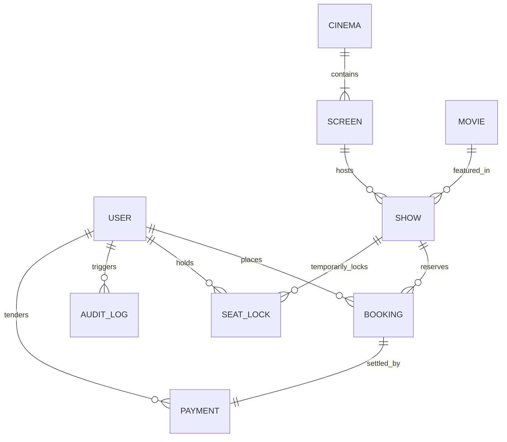

# CineBook – Full Stack Cinema Ticket Booking System

> **Brand Tagline:** *Your Movie. Your Seat. Your Experience.*

CineBook is a complete, production-grade cinema hall ticket booking platform built for customers and cinema administrators. Developed with a human-centric visual identity, CineBook features a dark charcoal aesthetic, rich typography, responsive layouts, real-time atomic seat concurrency protection, simulated multi-channel checkout, digital boarding tickets with QR code verification, and a comprehensive administration dashboard.

---

## 🌟 Key Features

### Customer-Facing Platform
- **Hero Premiere Showcase:** High-impact featured movie hero banner with backdrop artwork, certification, duration, and direct booking links.
- **Dynamic Catalog & Discovery:** Browse *Now Showing* and *Upcoming Premieres*, filter by genre and language, sort by popularity or rating, with debounced text search.
- **Multi-City & Theatre Picker:** Filter shows across major metros (Delhi, Mumbai, Chandigarh, Ludhiana) and view screen amenities (IMAX, 4DX, Dolby Atmos, 4K Laser).
- **Interactive Seat Map:** Auditorium layout with screen indicator bar, aisles, and tiered pricing (Recliner, Premium, Standard).
- **Concurrency & Double-Booking Protection:** Atomic seat locking with a 10-minute countdown timer. Prevents race conditions and simultaneous reservations by two customers.
- **Simulated Payment Gateway:** Multi-method demonstration checkout (UPI, Credit/Debit Card, Pay at Cinema Counter) ready for production gateway integration (Razorpay/Stripe).
- **Digital Movie Tickets:** Boarding pass-style digital tickets with QR codes (`CINEBOOK-VERIFY-{bookingId}`), printable and downloadable as high-resolution PDFs.
- **Self-Service Booking Management:** View upcoming and past movie orders, inspect tickets, and cancel eligible bookings (at least 1 hour prior to showtime) with automatic simulated refund processing.

### Administrator & Staff Portal
- **Real-Time Analytics Dashboard:** KPIs for gross revenue, total tickets, registered customers, and catalog volume. Interactive Recharts visualization for monthly turnover and weekly booking trends.
- **Ticket Gate & QR Scanner (Acceptance Criterion #4):** Dedicated staff entry flow to scan and validate digital ticket QR codes (`CINEBOOK-VERIFY-CB-XXXXXXXX`), record entry timestamps, admit patrons, and reject duplicate admission attempts or cancelled tickets.
- **Auditorium Occupancy & Audit Reports (Acceptance Criterion #5):** Reconciles total screen capacity against confirmed seats and cancelled bookings. Full immutable audit trail recording all material business mutations.
- **Manage Movies:** Full CRUD catalog management with instant file upload or URL linking for 2:3 posters and 16:9 banners, cast & director info, and one-click initial showtime scheduling.
- **Manage Cinemas:** Register multiplex venues, assign cities, street addresses, and auditorium amenities.
- **Auditorium & Screen Builder:** Screen capacity configuration, row labeling (A–H), and automated tiered pricing allocation.
- **Showtime Scheduler:** Schedule movie screenings across screens and dates with automatic collision detection to prevent overlapping shows.
- **Booking Management:** Live lookup by Booking ID, status filters (Confirmed, Pending, Cancelled), and administrative cancellation controls.
- **Customer Directory:** Track registered customer volumes, booking counts, and toggle account access blocks.
- **System Settings:** Configurable seat reservation lock duration, default convenience fees, and diagnostics.

---

## 💻 Technology Stack

| Layer | Technologies |
|---|---|
| **Frontend** | React 19, Vite, Tailwind CSS, React Router DOM v6, Axios, Lucide React, React Hot Toast, Recharts, QRCode.react, jsPDF, html2canvas, date-fns |
| **Backend** | Node.js, Express.js, REST API architecture, JWT authentication (`jsonwebtoken`), password hashing (`bcryptjs`), input validation (`express-validator`), rate limiting (`express-rate-limit`), Helmet security headers, CORS |
| **Database** | MongoDB 8.x with Mongoose ODM, TTL indexing for auto-expiring locks, unique compound indexes, atomic update operators |

---

## 📂 Project Structure

```
Cinema Hall/
├── client/                     # React + Vite Frontend
│   ├── public/                 # Static assets
│   ├── src/
│   │   ├── components/
│   │   │   ├── admin/          # Sidebar, StatCard
│   │   │   ├── booking/        # TicketView, BookingCard
│   │   │   ├── common/         # Navbar, Footer, LoadingSpinner, ProtectedRoute, AdminRoute
│   │   │   ├── movie/          # MovieCard, MovieFilters
│   │   │   └── seat/           # SeatMap, SeatLegend
│   │   ├── context/            # AuthContext (state, login/logout, tokens)
│   │   ├── hooks/              # useAuth
│   │   ├── layouts/            # MainLayout, AdminLayout
│   │   ├── pages/              # Home, Movies, MovieDetail, SeatSelection, Checkout,
│   │   │                       # BookingConfirmation, MyBookings, Login, Register, Profile
│   │   │   └── admin/          # Dashboard, ManageMovies, ManageCinemas, ManageScreens,
│   │   │                       # ManageShows, ManageBookings, ManageCustomers, AdminSettings
│   │   ├── services/           # Axios API services (auth, movie, cinema, show, seat, booking, admin)
│   │   ├── utils/              # constants, formatters
│   │   ├── App.jsx             # React Router routing configuration
│   │   ├── index.css           # Tailwind directives & design system tokens
│   │   └── main.jsx
│   ├── index.html
│   ├── tailwind.config.js
│   ├── vite.config.js
│   └── package.json
│
├── server/                     # Node.js + Express + MongoDB Backend
│   ├── config/                 # db.js (Mongoose connection)
│   ├── controllers/            # auth, movie, cinema, screen, show, seat, booking, payment, admin
│   ├── middleware/             # auth (JWT), admin (RBAC), errorHandler
│   ├── models/                 # User, Movie, Cinema, Screen, Show, Booking, Payment, SeatLock
│   ├── routes/                 # Express route definitions
│   ├── seed/                   # seedData.js (Database seeder with 10 movies, 3 cinemas, 150 shows)
│   ├── services/               # seatLockService (Atomic locking & concurrency)
│   ├── utils/                  # apiResponse, generateBookingId
│   ├── data/db/                # Local MongoDB data directory
│   ├── server.js               # Express application entry point
│   ├── .env                    # Environment variables
│   ├── .env.example
│   └── package.json
└── README.md
```

---

## 🗄️ Database Architecture & Concurrency Control

CineBook uses nine interconnected MongoDB collections:

1. **User:** Authentication credentials, role (`customer` or `admin`), profile details, and account block status.
2. **Movie:** Title, plot summary, genre array, duration in minutes, language array, certification, poster & backdrop paths, trailer URLs, and rating.
3. **Cinema:** Venue name, metro city, street address, and amenities list.
4. **Screen:** Linked to Cinema. Defines auditorium name, total seat capacity, and individual row configurations with tier pricing.
5. **Show:** Scheduled screenings linking Movie, Cinema, Screen, date, start/end time, and an array of permanently `bookedSeats`.
6. **SeatLock:** Temporary reservation documents with a TTL index on `expiresAt` (10 minutes) and a unique compound index `{ showId: 1, row: 1, seatNumber: 1 }`.
7. **Booking:** Unique reference ID (`CB-XXXXXXXX`), user reference, show reference, seat array, price breakdown, booking status (`pending`, `confirmed`, `cancelled`), gate admission status (`isAdmitted`, `admittedAt`).
8. **Payment:** Associated booking, payment method (`upi`, `card`, `cash`), transaction ID, and gateway response payload.
9. **AuditLog:** Immutable ledger of business-critical state mutations (`TICKET_ADMITTED`, `PAYMENT_COMPLETED`, `BOOKING_CANCELLED`, `BOOKING_CREATED`).

### Entity-Relationship Diagram (ERD)



### Concurrency Protection Mechanism
1. Before checkout, `POST /api/seats/lock` checks if requested seats are in `show.bookedSeats` or held in `SeatLock` by another user where `expiresAt > Date.now()`.
2. Locks are created atomically using an all-or-nothing guarantee.
3. When another user attempts to lock the same seats, the request is rejected with HTTP 400 (`"Seats are temporarily held by another user"`).
4. Upon successful payment verification, seats are pushed to `show.bookedSeats` and temporary locks are deleted. If the session expires or is cancelled, locks are cleaned up.

---

## 🚀 Setup & Installation Instructions (Windows PowerShell)

### Prerequisites
- **Node.js** (v18 or higher recommended)
- **MongoDB Server** (v6.x, 7.x, or 8.x)

### 1. Clone or Open the Workspace
```powershell
cd "d:\Projects\Cinema Hall"
```

### 2. Configure Backend Environment
Ensure `server/.env` exists with the following configuration:
```env
PORT=5000
MONGODB_URI=mongodb://127.0.0.1:27017/cinebook
JWT_SECRET=cinebook-super-secret-jwt-key-2024-change-in-production
JWT_EXPIRES_IN=7d
CLIENT_URL=http://localhost:5173
SEAT_LOCK_DURATION_MINUTES=10
NODE_ENV=development
ADMIN_EMAIL=admin@cinebook.com
ADMIN_PASSWORD=Admin@123
```

### 3. Start MongoDB
Run MongoDB with your local data directory:
```powershell
& "C:\Program Files\MongoDB\Server\8.3\bin\mongod.exe" --dbpath "d:\Projects\Cinema Hall\server\data\db" --bind_ip 127.0.0.1 --port 27017
```

### 4. Install Dependencies & Seed the Database
In a new PowerShell terminal:
```powershell
cd "d:\Projects\Cinema Hall\server"
npm install
npm run seed
```

### 5. Launch the Backend Server
```powershell
cd "d:\Projects\Cinema Hall\server"
npm start
```
*The server will run on `http://localhost:5000`.*

### 6. Launch the React Frontend
In a separate PowerShell terminal:
```powershell
cd "d:\Projects\Cinema Hall\client"
npm install
npm run dev
```
*The frontend client will be available at `http://localhost:5173`.*

---

## 👥 Demo Accounts

The database seed script initializes ready-to-test accounts:

| Role | Email | Password | Access Level |
|---|---|---|---|
| **Administrator** | `admin@cinebook.com` | `Admin@123` | Full access to Admin Portal, Movies, Cinemas, Screens, Shows, Bookings, Customers |
| **Customer 1** | `rahul@example.com` | `Password@123` | Customer browsing, booking, ticket download, cancellations |
| **Customer 2** | `priya@example.com` | `Password@123` | Customer account with existing order history |
| **Customer 3** | `amit@example.com` | `Password@123` | Customer account |

*Tip: The Sign In page includes quick-fill buttons for instant evaluation.*

---

## 📡 REST API Reference

### Authentication
- `POST /api/auth/register` – Register new customer
- `POST /api/auth/login` – Authenticate and receive JWT token
- `GET /api/auth/me` – Retrieve current user profile (Protected)
- `PUT /api/auth/change-password` – Update user password (Protected)

### Movies
- `GET /api/movies` – Query movies by genre, language, status, search, and sort
- `GET /api/movies/:id` – Retrieve movie details
- `POST /api/movies` – Create new movie (Admin Only)
- `PUT /api/movies/:id` – Update movie details (Admin Only)
- `DELETE /api/movies/:id` – Remove movie (Admin Only)

### Cinemas & Screens
- `GET /api/cinemas` – List active cinemas by city
- `POST /api/cinemas` – Create cinema venue (Admin Only)
- `GET /api/screens` – List auditorium screens by cinema
- `POST /api/screens` – Create screen layout with tiered pricing (Admin Only)

### Shows & Seat Management
- `GET /api/shows` – Query scheduled shows by movie, cinema, date, city
- `GET /api/shows/movie/:movieId` – Grouped shows by city, cinema, and date
- `GET /api/shows/:id/seats` – Real-time seat map with booked and locked states
- `POST /api/shows` – Schedule show with overlap collision check (Admin Only)
- `POST /api/seats/lock` – Atomically reserve seats for 10 minutes (Protected)
- `DELETE /api/seats/lock` – Release temporary seat holds (Protected)

### Bookings & Payments
- `POST /api/bookings` – Create pending booking from locked seats (Protected)
- `GET /api/bookings/my-bookings` – Retrieve customer booking history (Protected)
- `GET /api/bookings/:id` – Fetch booking reference with QR details (Protected)
- `PUT /api/bookings/:id/cancel` – Cancel eligible booking & simulate refund (Protected)
- `POST /api/bookings/verify-ticket` – Validate ticket QR identifier at cinema gate (Staff/Admin Only)
- `POST /api/payments/create` – Initiate simulated payment (Protected)
- `POST /api/payments/verify` – Verify payment, confirm booking, update auditorium (Protected)

### Administrator Portal
- `GET /api/admin/dashboard` – Overall revenue, ticket metrics, and analytics
- `GET /api/admin/bookings` – Paginated bookings with search & status filters
- `GET /api/admin/customers` – Customer accounts with booking counts
- `PUT /api/admin/customers/:id/block` – Toggle customer account access
- `GET /api/admin/reports` – Occupancy reconciliation report and immutable audit trail

---

## 🧪 Verification & Automated Testing

An automated end-to-end integration test suite is provided in `server/test_e2e.js`:

```powershell
node "d:\Projects\Cinema Hall\server\test_e2e.js"
```

### Core Workflow Verification Matrix

| # | Workflow / Scenario | Test Output & Evidence | Status |
|:---|:---|:---|:---:|
| **1** | Available seat hold & confirmed booking | Acquired atomic hold on seats $\rightarrow$ Created pending booking $\rightarrow$ Simulated payment $\rightarrow$ Booking confirmed | **PASSED** |
| **2** | Concurrency & double-booking protection | Second user attempted hold/booking on same seat $\rightarrow$ Rejected with `400 Conflict` | **PASSED** |
| **3** | Hold expiry & seat restoration | Released hold on seat returns to `available`; confirmed seat remains permanently `booked` | **PASSED** |
| **4** | Gate QR single-admission verification | Staff scans ticket QR $\rightarrow$ Admitted (success). Second scan attempt rejected with `409 Duplicate Entry Blocked` | **PASSED** |
| **5** | Occupancy reconciliation & audit trail | Reconciles: $\text{Total Capacity} = \text{Confirmed Seats} + \text{Available Seats}$. Reflects cancellations and refunds | **PASSED** |

---

## 📑 Technical Documentation

- **[TECHNICAL_REPORT.md](file:///d:/Projects/Cinema%20Hall/TECHNICAL_REPORT.md)** – Comprehensive technical report detailing architecture, concurrency pattern, data model, security design, and test evidence.
- **[API_DOCUMENTATION.md](file:///d:/Projects/Cinema%20Hall/API_DOCUMENTATION.md)** – Detailed REST API specification with request payloads, status codes, and error envelopes.

---

## 📄 License
This project was developed for the Full-Stack Web Development Advanced Assessment. All movie names, posters, and trademarks belong to their respective copyright holders.

